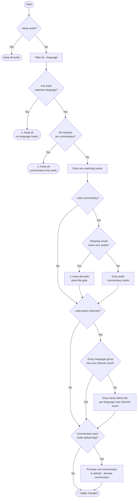
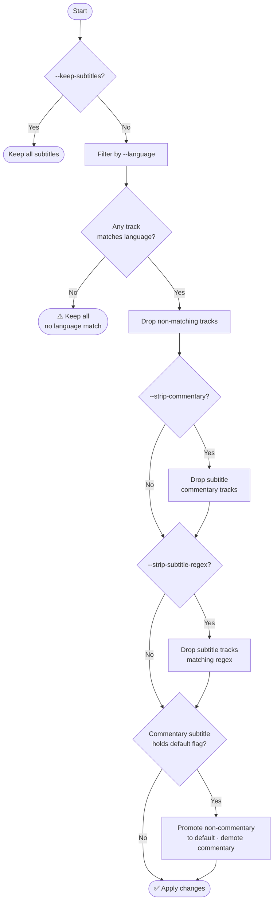
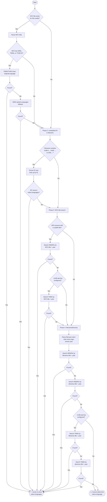

# Trimarr

Removes (trims) unwanted audio and subtitles from matroska container format video files.

## Features

- **Recursive scan** — finds all `.mkv` files under one or more specified directory trees. Pass a pipe-separated list
to `--media-path` to process multiple roots in a single run; duplicate files (from overlapping roots or from file
symlinks inside a scanned root) are automatically deduplicated. Symlinked *directories* are not descended into — add
the real path to `--media-path` instead (or pass the symlink itself as a root). Point trimarr at real files, not
symlinked `.mkv` files: a remux replaces the *link* with a regular file and leaves its target untouched.
- **Smart skip** — tracks processed files in SQLite using a fingerprint (size + mtime + partial
  hash); only reprocesses a file if its content has changed.
- **Commentary track safety** — if the default audio or subtitle track is a commentary track,
  trimarr demotes it and promotes the first non-commentary track to be the new default
  (whenever tracks of that type are being removed).
- **Multi-language support** — keep tracks in any combination of languages with a single
  comma-separated value, e.g. `--language eng,fre` retains both English and French.
- **Language safety fallbacks** — if *no* audio (or subtitle) tracks match the target language(s),
  all tracks of that type are kept to prevent accidentally silencing a file. Additionally, if all
  language-matching audio tracks are commentary (e.g. Director's Commentary on a foreign-language
  film), audio filtering is also skipped. A warning is logged in both cases.
- **Native language preservation** — with `--keep-native-audio`, trimarr identifies the file's
  original spoken language(s) via IMDb, TMDb, and TVDB — the lookup prioritises the
  **originalLanguage** from TMDb/TVDB over IMDb's broader
  spokenLanguages (which can include every language with any dialogue) — and preserves those
  audio tracks even if they don't match your `--language` preference. Ideal for dubbed films
  (e.g., keeping original Chinese audio alongside an English dub) and TV shows where Sonarr
  NFO files carry only a TVDB ID. Results are cached in the database so each
  file is looked up only once; a *failed* lookup is retried after 7 days so a
  transient outage or a missing API key does not disable the feature forever.
- **Auto-managed mkvmerge** — downloads the mkvmerge binary from MKVToolNix GitHub releases on
  first run and keeps it up to date automatically (disable with `--no-update-check`). The download is
  validated by magic bytes and size, but not by a published checksum; if you require a
  verifiable binary, install MKVToolNix yourself and point `--mkvmerge-path` at it.
- **Space savings summary** — reports bytes reclaimed at the end of each run and a cumulative
  all-time total across all sessions.
- **Graceful interrupt** — Ctrl+C shows a partial summary before exiting with code 130.
- **Distinct exit codes** — `0` success; `1` a fatal run-level error (tracking database unavailable, or the
  managed mkvmerge download failed); `2` a corrupt remux halted processing **or** a CLI usage error;
  `130` interrupted.
- **Safe file replacement** — output is written to a temp file first, then atomically renamed over
  the original so a failed remux never corrupts the source.
- **Corrupt output safeguard** — before replacing the original, trimarr probes the output with
  `mkvmerge -J` to confirm it is a structurally valid MKV and rejects any output smaller than 50 %
  of the source. A failed structural check halts all processing immediately and preserves the temp
  file for inspection. An undersized output fails only that file: the original is left untouched and
  the temp copy is removed. The size guard can be bypassed with
  `--skip-size-check` when legitimate remuxes are expected to produce significantly smaller output
  (e.g. files with very large audio or subtitle payloads).
- **BCP-47 / ISO 639-1 language tag support** — files using IETF `language_ietf` tags (e.g. `en`,
  `en-US`, `fr`) are automatically mapped to ISO 639-2 codes before matching, so `--language eng`
  correctly matches tracks tagged as either `eng` or `en`.
- **Failure report** — after the run summary, a consolidated list of every file that could not be
  processed is printed with a concise reason for each failure.

## Prerequisites

- [Python 3.12+](https://www.python.org/downloads/)
- [Astral uv](https://github.com/astral-sh/uv#installation) (optional)

## Quick start

### Installation using uv (recommended)

```bash
git clone https://github.com/binhex/trimarr
cd trimarr
uv venv --quiet
uv sync
```

### Installation using pip

```bash
git clone https://github.com/binhex/trimarr
cd trimarr
python -m venv .venv
source .venv/bin/activate
pip install .
```

### Usage

```bash
trimarr --help
```

## Options

| Option | Description | Default | Example | Type |
| ------ | ----------- | ------- | ------- | ---- |
| `--language` ✱ | One or more ISO 639-2 language codes (comma-separated) for the audio/subtitle tracks to keep. See [ISO 639-2 codes](http://en.wikipedia.org/wiki/List_of_ISO_639-2_codes). | — | `eng` or `eng,fre` | `string` |
| `--media-path` ✱ | Path(s) to the directory/directories containing media files to process (scanned recursively). Accepts a single path or a pipe-separated list of paths (using the pipe character as delimiter, safe even when directory names contain commas). | — | `/mnt/user/Movies` or `/mnt/user/Movies\|/mnt/media/tv` | `path` |
| `--mkvmerge-path` | Path to the mkvmerge executable. When omitted, trimarr manages its own binary and auto-updates it. | Linux: `~/.local/share/trimarr/bin/mkvmerge`<br>Windows: `%LOCALAPPDATA%\trimarr\bin\mkvmerge.exe` | `/usr/bin/mkvmerge` | `path` |
| `--database-path` | Path to the SQLite database file used for tracking processed files. | Linux: `~/.local/share/trimarr/db/trimarr.db`<br>Windows: `%LOCALAPPDATA%\trimarr\db\trimarr.db` | `/var/lib/trimarr/trimarr.db` | `path` |
| `--log-path` | Path to the log file for tracking application events. | Linux: `~/.local/share/trimarr/logs/trimarr.log`<br>Windows: `%LOCALAPPDATA%\trimarr\logs\trimarr.log` | `/var/log/trimarr.log` | `path` |
| `--log-level` | Logging level for the console and file sinks. Choices: `DEBUG`, `INFO`, `SUCCESS`, `WARNING`, `ERROR`. | `INFO` | `DEBUG` | `choice` |
| `--edit-metadata-title` | Update the container title metadata of each file to match its filename stem. Mutually exclusive with `--delete-metadata-title`. | `false` | — | `flag` |
| `--delete-metadata-title` | Remove the container title metadata from each file. Mutually exclusive with `--edit-metadata-title`. | `false` | — | `flag` |
| `--keep-subtitles` | Keep all subtitle tracks regardless of language. | `false` | — | `flag` |
| `--keep-audio` | Keep all audio tracks regardless of language. | `false` | — | `flag` |
| `--keep-native-audio` | Identify the file's native/original spoken language(s) via IMDb, TMDb, and TVDB — the lookup prioritises the **originalLanguage** from TMDb/TVDB (a single production language code) over IMDb's broader spokenLanguages (all languages with any dialogue). The chain internally orders by media type: TMDb first for movies, TVDB first for TV shows. Keeps all audio tracks in those languages alongside your `--language` preference. Ignored when `--keep-audio` is set. First-time lookups require an internet connection; results are cached in the database. | `false` | — | `flag` |
| `--keep-undefined-audio` | If specified, audio tracks with an undefined language code ("und") are kept rather than dropped by the language filter. Useful when source files have missing or incorrect language tags. Ignored when `--keep-audio` is set. | `false` | — | `flag` |
| `--tmdb-api-key` | TMDb API key. For NFO ID lookups TMDb `originalLanguage` is tried first for movies (TVDB first for TV shows); an IMDb ID embedded in the filename is still resolved before an embedded TMDb ID, and IMDb `spokenLanguages` is the fallback after a TMDb miss. Optional — without it, TMDb lookups are silently skipped. | — | `<key>` | `string` |
| `--tvdb-api-key` | TVDB API key. For TV shows TVDB `originalLanguage` is tried before TMDb in NFO ID lookups; for movies it is the fallback after TMDb. Needed for TV shows whose NFO files carry only a TVDB ID. Optional — without it, TVDB lookups are silently skipped. | — | `<key>` | `string` |
| `--no-backup` | Delete the original file after successful processing instead of renaming it to `<name>.bak`. By default a backup is always created. | `false` | — | `flag` |
| `--no-update-check` | Skip the automatic check for a newer mkvmerge version. Has no effect when `--mkvmerge-path` is supplied (user-managed binaries are never auto-updated). | `false` | — | `flag` |
| `--strip-lower-channels` | After language filtering, drop any audio track whose channel count is strictly below the highest channel count among the surviving audio tracks **of the same language**. Commentary tracks are exempt from this filter (they are neither counted nor dropped) — use `--strip-commentary` to remove them. For example, with `--language eng,fre` and English tracks at 8ch, 8ch, and 2ch, the 2ch English track is removed while a 2ch French track is kept. Tracks with an unknown channel count are always kept. Has no effect when `--keep-audio` is set. **Disabled by default** — enable only when you are confident lower-channel duplicates are not needed. | `false` | — | `flag` |
| `--strip-commentary` | If specified, audio and subtitle tracks whose name contains "commentary" (case-insensitive) will be removed after language filtering. **Audio final gate:** if stripping would leave zero audio tracks, all audio is retained and a warning is logged — a silent file is never acceptable. Subtitles have no such gate and are stripped whenever the subtitle language fallback has not fired (if no subtitle matches `--language`, all subtitles are kept and commentary stripping is skipped). Has no effect on audio when `--keep-audio` is set, or on subtitles when `--keep-subtitles` is set. **Disabled by default.** | `false` | — | `flag` |
| `--strip-subtitle-regex` | One or more Python regex patterns. Any subtitle track whose name matches any pattern is removed after language filtering, regardless of language. Runs after `--strip-commentary`. Not applied when the subtitle language fallback triggers (no subtitle matches `--language`, so all subtitles are kept). Specify multiple times for multiple patterns (e.g. `--strip-subtitle-regex '(?i)songs.*signs' --strip-subtitle-regex '(?i)signs.*songs'`). Has no effect when `--keep-subtitles` is set. **Disabled by default.** | `()` | `'(?i)songs.*signs'` | `string (repeatable)` |
| `--dry-run` | Log planned changes without modifying any media file, and without writing processed-file or cache rows. An existing tracking database may still be opened and upgraded (and none is created). | `false` | — | `flag` |
| `--schedule` | Run on a cron schedule (instead of once). Standard 5-field POSIX cron expression: minute hour day month weekday. Also accepts `@hourly`, `@daily`, `@weekly`, `@monthly`, `@yearly`. Examples: `'0 2 * * *'` (daily at 2am), `'*/30 * * * *'` (every 30 min), `'@daily'` (once per day). When omitted, trimarr runs once and exits. | — | — | `string` |
| `--run-on-start` | When used with `--schedule`, execute an immediate run before the first scheduled cron fire. Without `--schedule` this flag is an error. | `false` | — | `flag` |
| `--skip-size-check` | Bypass the output size guard that rejects mkvmerge results smaller than 50 % of the source file. Use when legitimate remuxes are expected to produce significantly smaller output (e.g. files with very large audio or subtitle payloads). The structural validity check (`mkvmerge -J`) is never bypassed. | `false` | — | `flag` |
| `--pre-process` | Command to run **before** processing files in each directory. Executed directly, **without a shell** — the template is split POSIX-style, so pipes, redirection, globbing and `$VAR` are literal arguments. The placeholders `{leaf}` (directory basename) and `{dir}` (full directory path) are substituted. Fires once per directory that has work, except with `--keep-native-audio`, where it fires for every directory (the per-file profile cannot be known without probing). Failures are logged as warnings and do not abort the run. May be used independently of `--schedule`. | — | `'no_ransom.sh --unlock yes {leaf}'` | `string` |
| `--post-process` | Command to run **after** processing files in each directory. Same placeholder and no-shell behaviour as `--pre-process`. Fires even if some files in the directory failed. | — | `'no_ransom.sh --unlock no {leaf}'` | `string` |
| `--command-timeout-mins` | Maximum time in minutes each pre/post process command is allowed to run before being killed. Set to `0` to disable the timeout entirely. | `5` | `10` | `int` |

✱ Required.

> **Note:** Default paths are platform-aware. On Linux, paths respect `XDG_DATA_HOME` (if set to
> an absolute path, trimarr uses `$XDG_DATA_HOME/trimarr/`). On Windows, `%LOCALAPPDATA%` is used
> (falling back to `%APPDATA%`).

## How it works

Trimarr evaluates audio and subtitle tracks independently for each file.

### Audio tracks



### Subtitle tracks



> If a file needs no changes (all tracks already match, no metadata to edit), it is marked as
> processed in the database and skipped on all future runs — unless the file content or processing
> profile changes.

> **Native audio preservation:** When `--keep-native-audio` is enabled, trimarr identifies the
> media file's original spoken language(s) and merges them into the effective language list *before*
> the `Filter by --language` step. This means the native language is treated identically to a
> user-supplied language — all existing safeguards (audio fallback, commentary stripping,
> channel stripping) apply uniformly. The lookup result is cached in the database so each
> unique file is resolved only once.

### Native language resolution flow

When `--keep-native-audio` is enabled, trimarr walks the following four-phase chain to identify
the movie or TV show and look up its original spoken language(s): (1) IDs found in the NFO file,
(2) an ID embedded in the filename, (3) a title search using the clean NFO title, then (4) parsing
the filename and directory name. **Phase 1 (NFO IDs)** tries TMDb/TVDB `originalLanguage` first —
ordered by media type, TMDb first for movies and TVDB first for TV shows — then IMDb
`spokenLanguages` as a fallback. **Phase 2 (embedded IDs)** is different on purpose: an embedded
IMDb ID is resolved before an embedded TMDb/TVDB ID, because that ID is the one the release was
named after. Each level is attempted in order; the first successful result is cached in the
database and returned (a failed lookup is re-attempted after 7 days). Title searches go through
IMDbPie and TMDb only — TVDB is queried by ID.



## Scheduler

By default trimarr runs once and exits. Pass `--schedule` with a cron expression to run on a
timed schedule.

```bash
# Run daily at 2 AM
trimarr --language eng --media-path /mnt/media --schedule "0 2 * * *"

# Run every 30 minutes, with an immediate run on startup
trimarr --language eng --media-path /mnt/media --schedule "*/30 * * * *" --run-on-start

# Using a special keyword
trimarr --language eng --media-path /mnt/media --schedule "@daily"
```

### Schedule format

`--schedule` accepts a standard 5-field POSIX cron expression:

| Field | Values     | Description                |
|-------|------------|----------------------------|
| `min` | 0–59       | Minute of the hour         |
| `hour` | 0–23       | Hour of the day            |
| `day` | 1–31       | Day of the month           |
| `mon` | 1–12       | Month (1 = January)        |
| `wday` | 0–7 (0,7 = Sunday) | Day of the week      |

Each field supports **wildcards** (`*`), **ranges** (`9-17`), **lists** (`9,18`), and **steps** (`*/30`, `0-30/10`).

Special keyword shortcuts (via croniter):

| Keyword     | Equivalent         |
|-------------|--------------------|
| `@hourly`   | `0 * * * *`        |
| `@daily`    | `0 0 * * *`        |
| `@weekly`   | `0 0 * * 0`        |
| `@monthly`  | `0 0 1 * *`        |
| `@yearly`   | `0 0 1 1 *`        |

### Pre/Post process hooks

Use `--pre-process` and `--post-process` to run a command before and after trimarr
processes files in a directory. This is useful for external operations such as unlocking
files before processing and re-locking them afterwards.

The hooks fire **once per directory** that has files needing processing, not per file.
`{leaf}` and `{dir}` placeholders in the command template are replaced with the directory
basename and full path respectively.

Hook commands are **not** run through a shell: the template is split POSIX-style and executed
directly, so `|`, `>`, `&&`, `$VARS` and globs are passed as literal arguments. Wrap such logic
in a script and call that instead. On Windows the template is split non-POSIX, so quotes stay part of
the token. Hooks are skipped entirely during `--dry-run`, and with `--keep-native-audio` (without
`--keep-audio`) they fire for every directory (the per-file profile cannot be known without probing).

```bash
# Run a script before and after processing each directory
trimarr --language eng --media-path /mnt/media \
  --pre-process 'no_ransom.sh --unlock yes {leaf}' \
  --post-process 'no_ransom.sh --unlock no {leaf}' \
  --schedule "0 2 * * *"

# Only pre-process (no post-process), with a 10-minute timeout
trimarr --language eng --media-path /mnt/media \
  --pre-process 'prepare_dir.sh {dir}' \
  --command-timeout-mins 10
```

**Notes:**

- Hooks are independent — use one, both, or neither.
- A non-zero exit code from a hook logs a warning but does **not** stop processing.
- If a hook times out (per `--command-timeout-mins`), the process is killed and a warning is logged.
- Set `--command-timeout-mins 0` to disable the timeout entirely.

### Cron-driven scheduling

The scheduler stays running and recomputes the next fire time from the cron expression after
each run. If a run takes longer than the gap to the next scheduled fire, the missed fire
is skipped automatically and a warning is logged. This approach naturally handles overruns
without drift accumulation.

A run that cannot reach its tracking database (locked file, read-only mount) logs the error and
retries at the next scheduled fire rather than stopping the scheduler. A corrupt-output halt
(exit code 2) still stops it, and Ctrl+C exits cleanly with code 0.

### Stopping the scheduler

Press **Ctrl+C** at any time. The scheduler logs `Scheduler stopped.` and exits with code 0.

## Development

```bash
git clone https://github.com/binhex/trimarr
cd trimarr
uv venv --quiet
uv sync --extra dev
```

If you wish to perform linting on all files before committing (PR will not be
accepted if it does not pass all linting) then run `pre-commit run --all-files`.

## FAQ

WIP

___
If you appreciate my work, then please consider buying me a beer  :D

[](https://www.paypal.com/cgi-bin/webscr?cmd=_s-xclick&hosted_button_id=MM5E27UX6AUU4)
